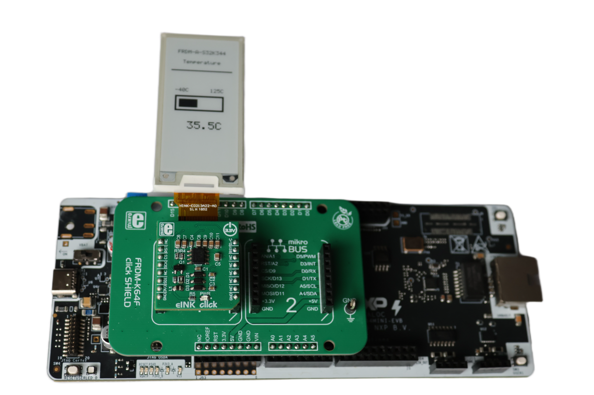
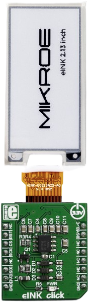
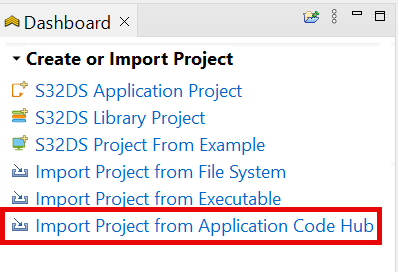
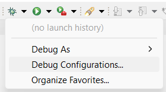
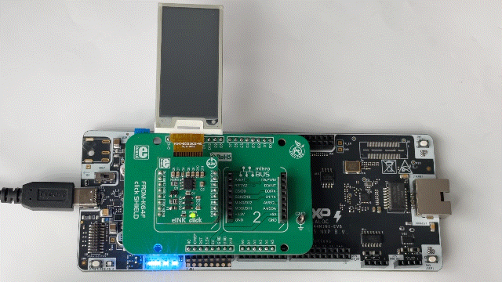

# NXP Application Code Hub

## E-Paper Temperature Display
This example demonstrates a live temperature gauge on an e-paper display, using the E-Paper Bundle 2 (eINK Click + Display) with the FRDM K64 Click Shield on the FRDM-A-S32K344 board. It reads the on-chip TempSense via the ADC SAR RTD low-level driver and renders the junction temperature as a horizontal bar gauge with a large numeric readout on an SSD1675A e-paper panel driven over an LPSPI channel.
[
](./images/FRDM-A-S32K344-Epaper-Temperature-Display.png)

#### Boards: FRDM-A-S32K344
#### Categories: Low Power, Analog Front End
#### Peripherals: ADC, SPI
#### Toolchains: S32 Design Studio IDE

## Table of Contents
1. [Software and Tools](#step1)
2. [Hardware](#step2)
3. [Setup](#step3)
4. [Results](#step4)
5. [Support](#step5)
6. [Release Notes](#step6)

## 1. Software and Tools
This example was developed using the FRDM Automotive Bundle for S32K3 + S32M27. To download and install the complete software and tools ecosystem, use the following link:
- [ FRDM Automotive S32K3 + S32M27 Board Installation Package](https://www.nxp.com/app-autopackagemgr/automotive-software-package-manager:AUTO-SW-PACKAGE-MANAGER?currentTab=0&selectedDevices=S32K3&applicationVersionID=203)

## 2. Hardware
### 2.1 Required Hardware
- Personal Computer
- Type-C USB cable
  
| Boards | Images |
| ----------- | ------- |
| - [FRDM-A-S32K344](https://www.nxp.com/design/design-center/development-boards-and-designs/FRDM-A-S32K344) |  |
| - [FRDM K64 Click Shield](https://www.mikroe.com/frdm-k64-click-shield) | 
 |
| - [E-Paper Bundle 2 (eINK click)](https://www.mikroe.com/e-paper-bundle-2) | 
   |

### 2.2 Hardware Connections
| FRDM-A-S32K344       | I/O | Click Board | Click Pin | Description                     |
|----------------------|-----|-------------|-----------|---------------------------------|
| PTB14 LPSPI1_SCK     | ->  | eINK click  | SCK       | SPI clock                       |
| PTB16 LPSPI1_SOUT    | ->  | eINK click  | SDI       | SPI data out (MOSI)             |
| PTB17 GPIO           | ->  | eINK click  | CS        | Chip select (active low)        |
| PTA1 GPIO            | ->  | eINK click  | D/C       | Data/Command select             |
| PTE1 GPIO            | ->  | eINK click  | RST       | Reset (active low)              |
| PTD2 GPIO            | <-  | eINK click  | BUSY      | Busy status from panel          |
| GND                  | ->  | eINK click  | GND       | Ground                          |
| VDD_PERH             | ->  | eINK click  | 3V3       | Power Supply                    |

### 2.3 Debugger Connection
- Connect the Type-C USB cable to PC and FRDM-A-S32K344 board for power supply and debugging

## 3. Setup

### 3.1 Import the Project into S32 Design Studio IDE
1. Open S32 Design Studio IDE, in the Dashboard Panel, choose **Import project from Application Code Hub**.
   [

](./images/import_project_1.png)

2. Find the demo by searching: [E-Paper Temperature Display](https://mcuxpresso.nxp.com/appcodehub?search=dm-epaper-temperature-display-s32k344)
3. Open the project, click the **GitHub link**, S32 Design Studio IDE will automatically retrieve project attributes, then click **Next>**.
    [

](./images/import_project_3.png)

4. Select **main** branch and then click **Next>**.

5. Select your local path for the repo in **Destination->Directory:** window. The S32 Design Studio IDE will clone the repo into this path, click **Next>**.

6. Select **Import existing Eclipse projects** then click **Next>**.

7. Select the project in this repo (only one project in this repo) then click **Finish**.

### 3.2 Generating, Building and Running the Example
1. In Project Explorer, right-click the project and select **Update Code and Build Project**. This will generate the configuration (Pins, Clocks, Peripherals, ADC), update the source code and build the project using the active configuration (e.g. Debug_FLASH).
Make sure the build completes successfully and the *.elf file is generated without errors.
[

](./images/update_and_build.png)
Press **Yes** in the **SDK Component Management** pop-up window to continue.

2. Go to **Debug** and select **Debug Configurations**. There will be a debug configuration for this project:
[

](./images/Debug_config.png)

        Configuration Name                  Description
        -------------------------------     -----------------------
        $(example)_debug_flash_pemicro      Debug the FLASH configuration using PEmicro probe

    Select the desired debug configuration and click on **Debug**. Now the perspective will change to the **Debug Perspective**.
    Use the controls to control the program flow.

## 4. Results
The demo reads the on-chip junction temperature via the ADC SAR TempSense channel (ch49) using the RTD low-level driver and drives an SSD1675A/IL3897 (HINK-E0213A22/TSE0213A189/GDEH0213B72) e-paper panel over SPI to render a live temperature gauge:
[
](./images/FRDM-A-S32K344-Epaper-Temperature-Display-Demo.gif)

- **Display Initialisation:** At start-up the panel is hardware reset and configured through the SSD1675A command sequence (block control, driver output, border, drive voltages, RAM window) with custom full and partial waveform LUTs uploaded, then cleared to a white background.

- **Temperature Gauge Rendering:** A framebuffer-based drawing layer renders the title lines ("FRDM-A-S32K344" and "Temperature"), a horizontal bar gauge scaled from -40 C to +125 C, range labels, and a large numeric temperature readout (e.g. "+27.5C") using a built-in 5x7 bitmap font.

- **Live Updates:** The main loop reads a new temperature sample via `Adc_Sar_Ip_TempSenseGetTemp` once per second. The Q11.4 fixed-point result is converted to a float and the display is updated using a flicker-free partial refresh (partial waveform, 0x22=0x04) on each frame, with a periodic full refresh (0x22=0xC4) every 60 frames to clear ghosting.

- **ADC Configuration:** The ADC SAR IP is initialised with the TempSense channel enabled, ADC calibration performed at startup, and `OSIF_COUNTER_DUMMY` used for the internal conversion timeout (busy-poll mode, no OS timer required).

## 5. Support
For general technical questions related to NXP microcontrollers, please use the [NXP Community Forum](https://community.nxp.com/).
#### Project Metadata

<!----- Boards ----->

<!----- Categories ----->

<!----- Peripherals ----->

<!----- Toolchains ----->

Questions regarding the content/correctness of this example can be entered as Issues within this GitHub repository.

>**Note**: For more general technical questions regarding NXP Microcontrollers and the difference in expected functionality, enter your questions on the [NXP Community Forum](https://community.nxp.com/)

## 6. Release Notes
| Version | Description / Update                           | Date                         |
|:-------:|------------------------------------------------|-----------------------------:|
| 1.0     | Initial release on Application Code Hub        | October 14th 2026 |
